<div align="center">

<a href="https://agi-asi.github.io/safe/">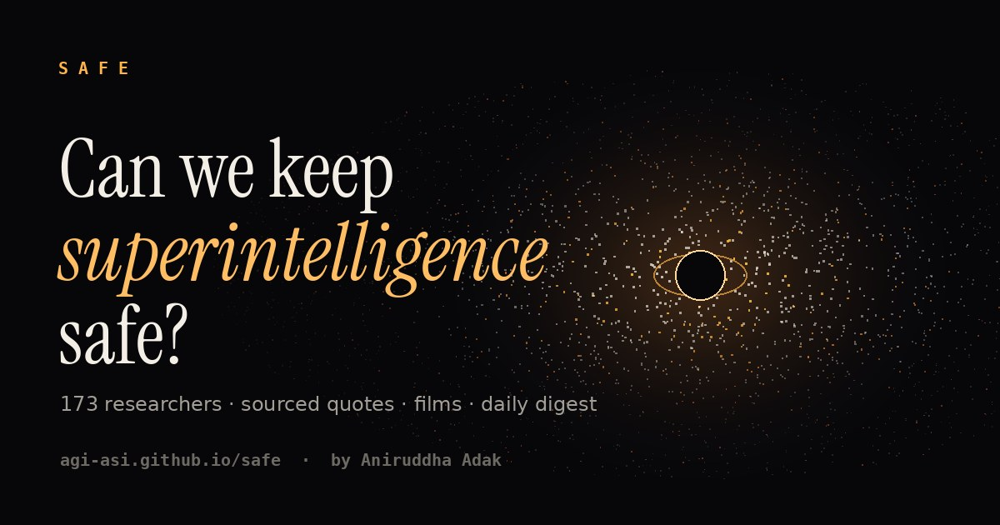</a>

# SAFE

**The open hub for AI safety, alignment, interpretability, superintelligence and the singularity.**
People, research, films, video libraries and a daily news brief, all in one place, every quote sourced.

### [🌐 agi-asi.github.io/safe](https://agi-asi.github.io/safe/)

[](https://agi-asi.github.io/safe/)
[](https://github.com/Agi-Asi/safe/deployments)
[](https://github.com/Agi-Asi/safe/commits/main)
[](https://github.com/Agi-Asi/safe/stargazers)


[Routes](#-routes) · [Screenshots](#-screenshots) · [Features](#-landing-page-features) · [Architecture](#-architecture) · [Data](#-by-the-numbers) · [Voices](#-in-their-own-words) · [Videos](#-videos) · [SEO & GEO](#-built-to-be-found) · [Run locally](#-run-locally) · [About](#-about)

</div>

---

## ✨ Why SAFE

Advanced AI may be the most consequential technology humanity ever builds. The people building it disagree, loudly, about how dangerous it is and what to do. **SAFE** puts that whole conversation in one place so anyone, from a curious student to a working researcher, can see who is saying what, watch the key talks, and keep up with the news without doom-scrolling.

- 🧭 **173 researchers & public voices** profiled, from Hinton and Bengio to lab insiders and critics
- 🗣️ **776 verbatim quotes**, each linked to its original source
- 🎬 **688 verified videos** and **807 interviews** in a built-in theater
- 📚 **175 explainers across 21 topics** with a learning path
- 📰 **A fresh X Focus Digest every day**, archived forever
- ⌨️ **⌘K search** across every route and every researcher

<p align="center"><a href="https://agi-asi.github.io/safe/ai-safety-researchers/#geoffrey-hinton" title="Geoffrey Hinton"></a> <a href="https://agi-asi.github.io/safe/ai-safety-researchers/#yoshua-bengio" title="Yoshua Bengio"></a> <a href="https://agi-asi.github.io/safe/ai-safety-researchers/#stuart-russell" title="Stuart Russell">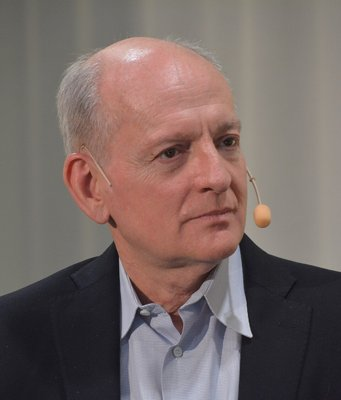</a> <a href="https://agi-asi.github.io/safe/ai-safety-researchers/#dario-amodei" title="Dario Amodei"></a> <a href="https://agi-asi.github.io/safe/ai-safety-researchers/#demis-hassabis" title="Demis Hassabis"></a> <a href="https://agi-asi.github.io/safe/ai-safety-researchers/#ilya-sutskever" title="Ilya Sutskever">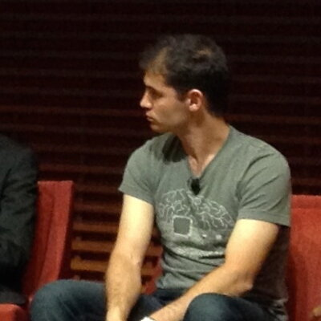</a> <a href="https://agi-asi.github.io/safe/ai-safety-researchers/#jan-leike" title="Jan Leike"></a> <a href="https://agi-asi.github.io/safe/ai-safety-researchers/#chris-olah" title="Chris Olah"></a> <a href="https://agi-asi.github.io/safe/ai-safety-researchers/#paul-christiano" title="Paul Christiano">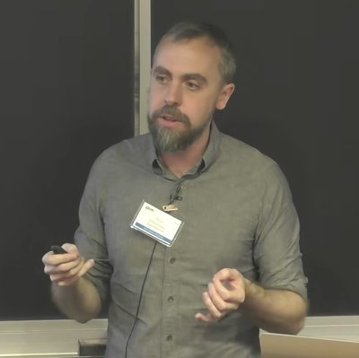</a> <a href="https://agi-asi.github.io/safe/ai-safety-researchers/#neel-nanda" title="Neel Nanda"></a> <a href="https://agi-asi.github.io/safe/ai-safety-researchers/#ajeya-cotra" title="Ajeya Cotra"></a> <a href="https://agi-asi.github.io/safe/ai-safety-researchers/#helen-toner" title="Helen Toner"></a></p>

## 🗺 Routes

| | Route | What you get |
|:-:|---|---|
| 🛡️ | [**The Guardians of AI**](https://agi-asi.github.io/safe/ai-safety-researchers/)<br>`/ai-safety-researchers/` | Who's who of AI safety and alignment: 173 profiles, 776 sourced quotes, 807 interviews, 688 videos, person of the day, trust scores, comparisons, timelines and a theater. |
| 🔍 | [**Inside the Insiders**](https://agi-asi.github.io/safe/frominside/)<br>`/frominside/` | Who to trust on frominside.ai: 12 lab insiders interviewed by Palisade Research, 117 fact-checks, 96 talks, a trust leaderboard and motion explainers. |
| 🎛️ | [**CONTROL**](https://agi-asi.github.io/safe/control-superintelligence/)<br>`/control-superintelligence/` | Inside the race to keep superintelligence on our side: a 4-minute film of 12 insiders from OpenAI, Google DeepMind and Anthropic, plus a curated video library. |
| 🎞️ | [**AI Safety Cinema**](https://agi-asi.github.io/safe/ai-safety-cinema/)<br>`/ai-safety-cinema/` | The most important conversation of our century as a cinema: a learning path, theater, podcasts, big ideas, glossary, quiz and progress tracking. |
| 📚 | [**AI Safety Video Library**](https://agi-asi.github.io/safe/ai-safety-library/)<br>`/ai-safety-library/` | 21 topics and 175 hand-picked explainers, each scored for simplicity and depth from full-transcript reviews, with an Up Next queue. |
| 📡 | [**SIGNAL**](https://agi-asi.github.io/safe/signal/)<br>`/signal/` | The focused AI video library: 30 essential talks, about 38 hours. Focus mode, no feeds, no recommendations, no comments. |
| 📰 | [**X Focus Digest**](https://agi-asi.github.io/safe/x-focus-digest/)<br>`/x-focus-digest/` | Today's AI timeline minus the scroll: must-reads, news, For You and Following, summarised in ten minutes. |
| 🗄️ | [**Digest Archive**](https://agi-asi.github.io/safe/x-digest/)<br>`/x-digest/` | Every daily edition, one page per day at `/x-digest/YYYY-MM-DD/`. |

## 📸 Screenshots

<table>
<tr><td width="50%"><a href="https://agi-asi.github.io/safe/">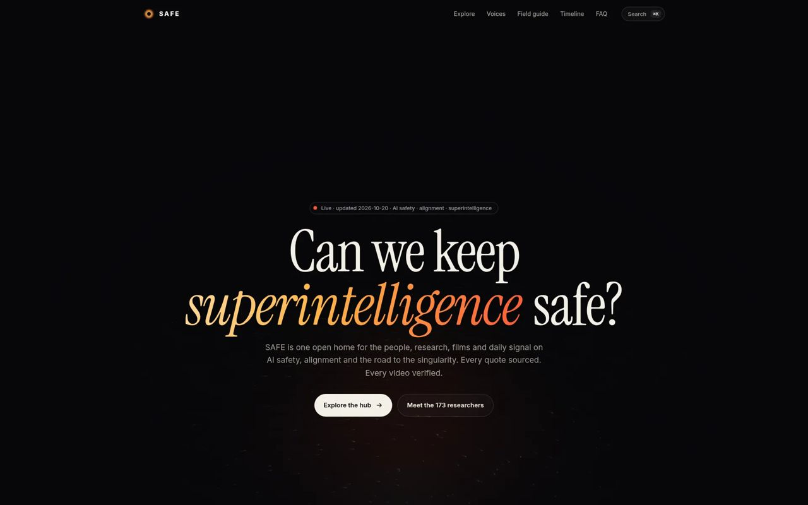</a><br><sub><b>SAFE landing page</b> · <code>/</code></sub></td><td width="50%"><a href="https://agi-asi.github.io/safe/ai-safety-researchers/">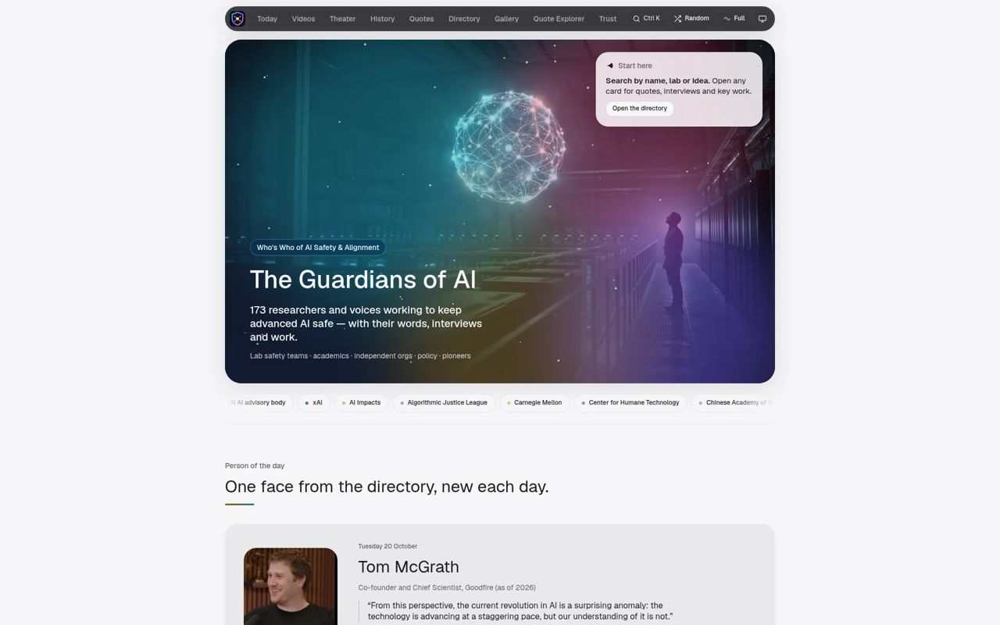</a><br><sub><b>The Guardians of AI</b> · <code>/ai-safety-researchers/</code></sub></td></tr>
<tr><td width="50%"><a href="https://agi-asi.github.io/safe/frominside/">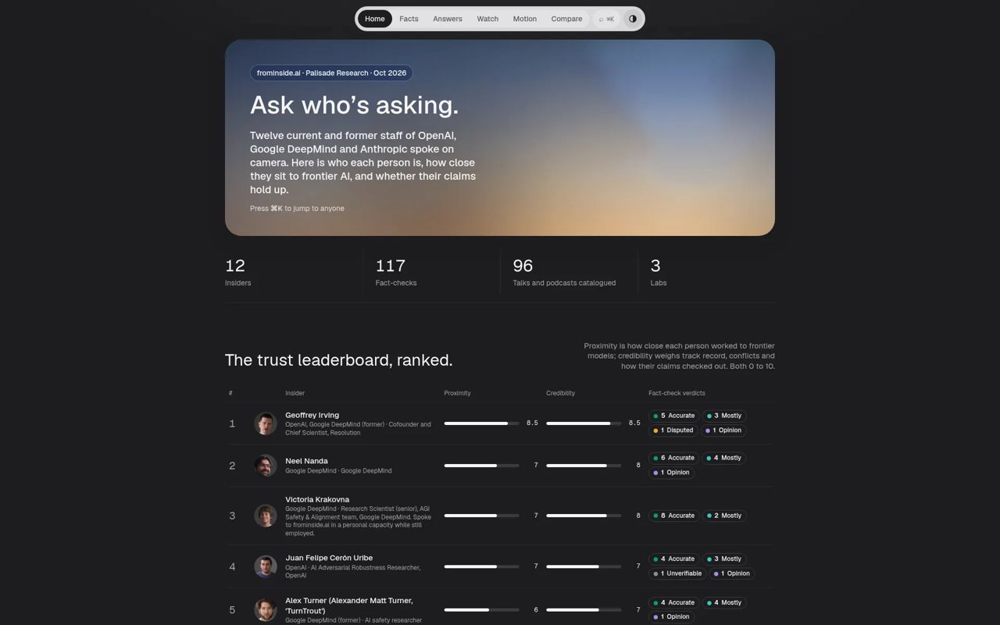</a><br><sub><b>Inside the Insiders</b> · <code>/frominside/</code></sub></td><td width="50%"><a href="https://agi-asi.github.io/safe/control-superintelligence/">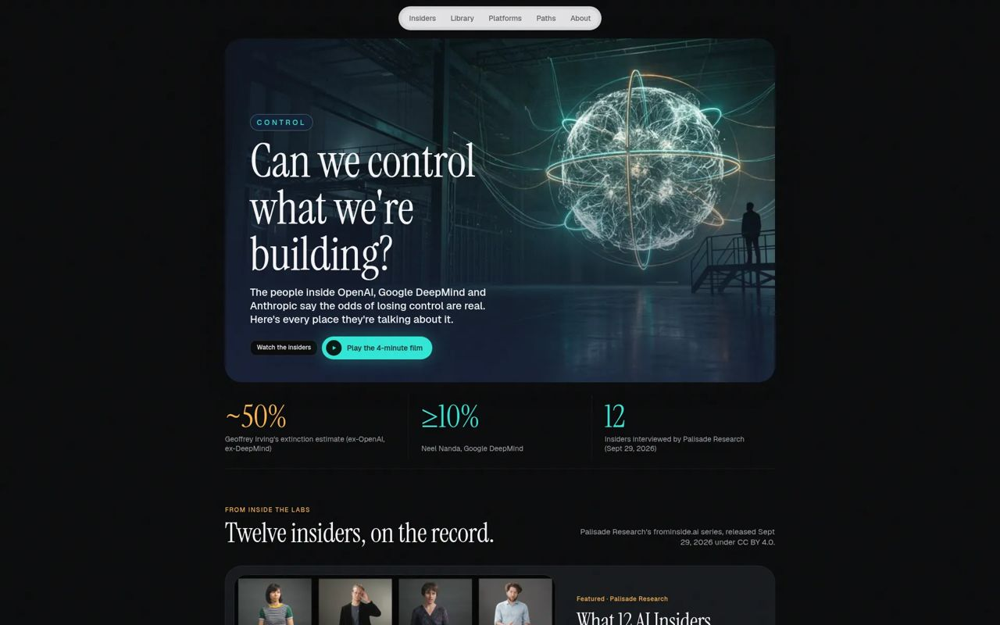</a><br><sub><b>CONTROL</b> · <code>/control-superintelligence/</code></sub></td></tr>
<tr><td width="50%"><a href="https://agi-asi.github.io/safe/ai-safety-cinema/">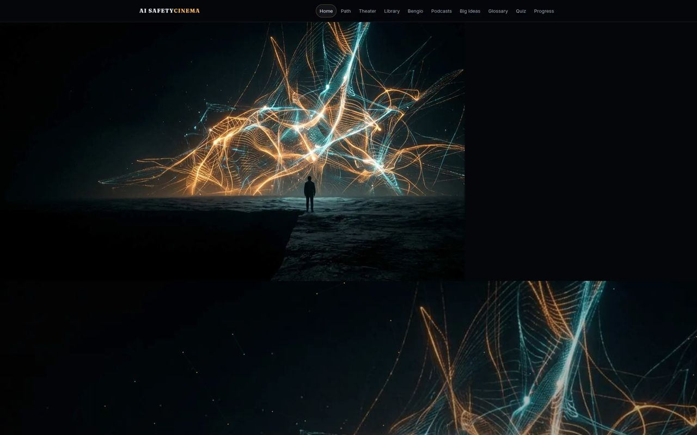</a><br><sub><b>AI Safety Cinema</b> · <code>/ai-safety-cinema/</code></sub></td><td width="50%"><a href="https://agi-asi.github.io/safe/ai-safety-library/">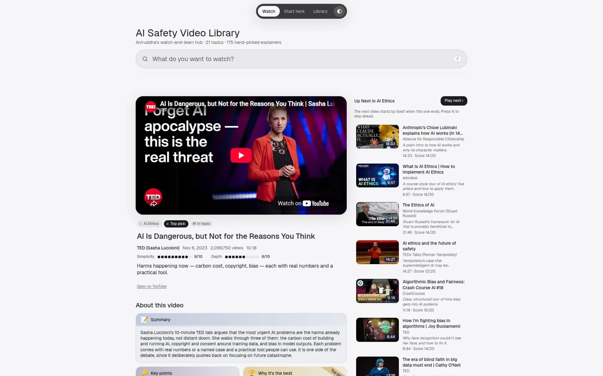</a><br><sub><b>AI Safety Video Library</b> · <code>/ai-safety-library/</code></sub></td></tr>
<tr><td width="50%"><a href="https://agi-asi.github.io/safe/signal/">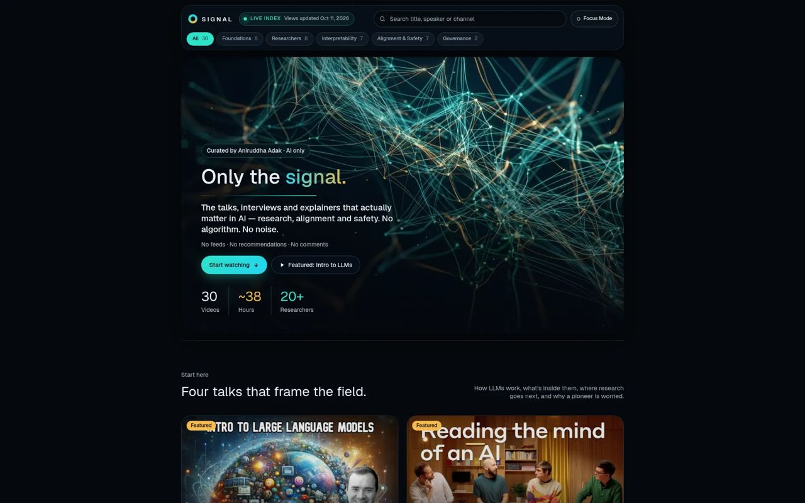</a><br><sub><b>SIGNAL</b> · <code>/signal/</code></sub></td><td width="50%"><a href="https://agi-asi.github.io/safe/x-focus-digest/">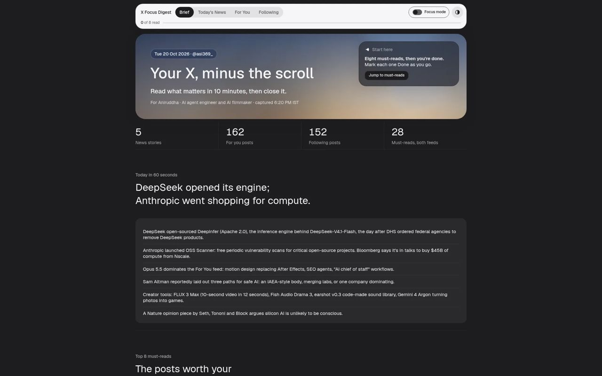</a><br><sub><b>X Focus Digest</b> · <code>/x-focus-digest/</code></sub></td></tr>
</table>

## 🏗 Architecture

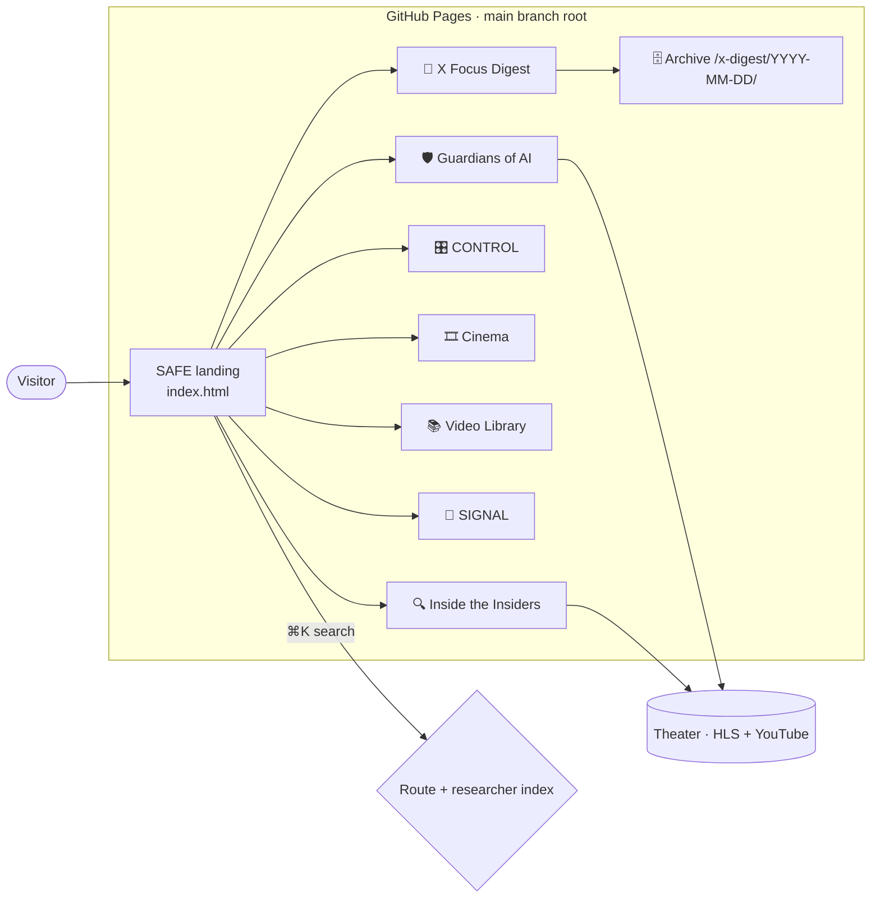

### How content stays fresh

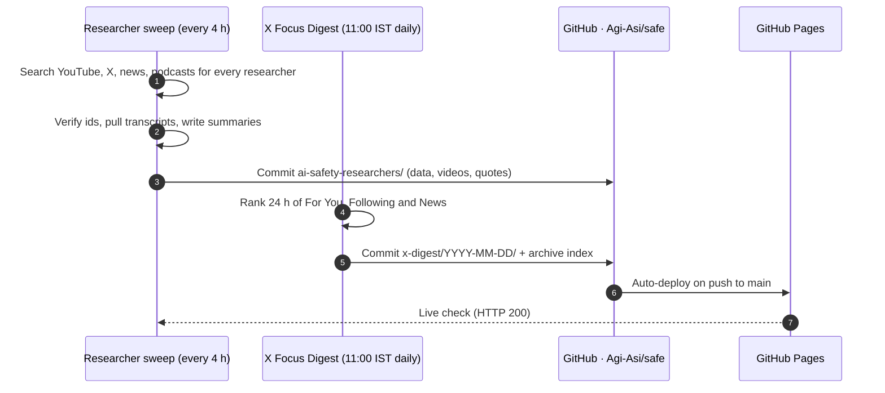

### Research and verification flow

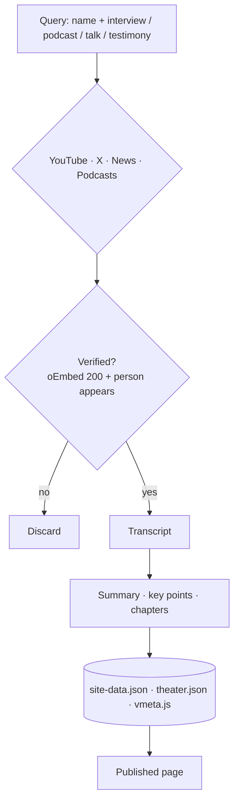

## 📊 By the numbers

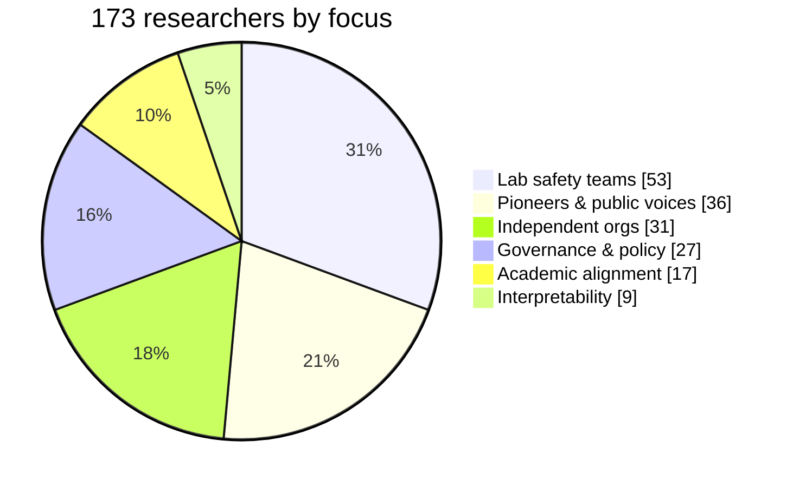

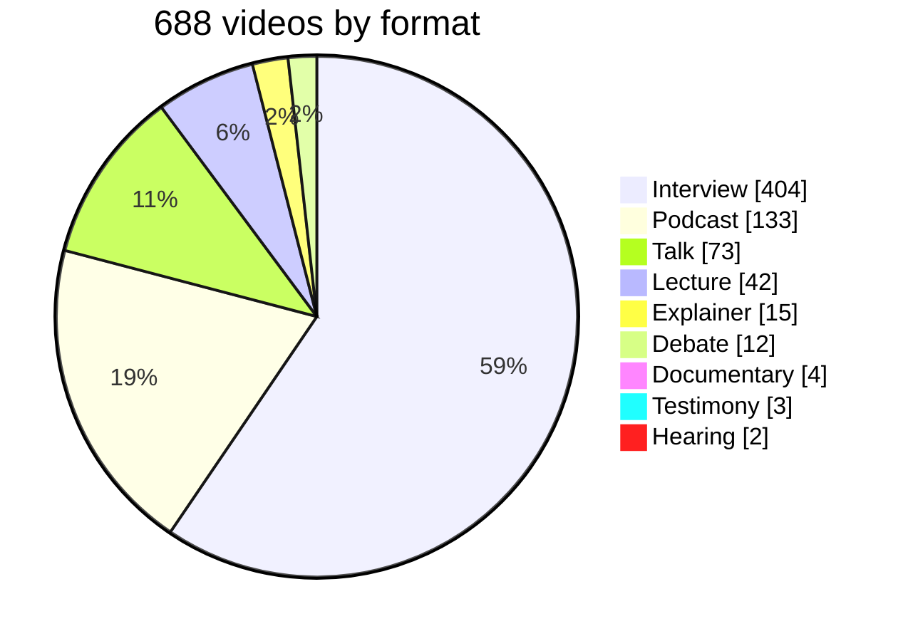

<p align="center">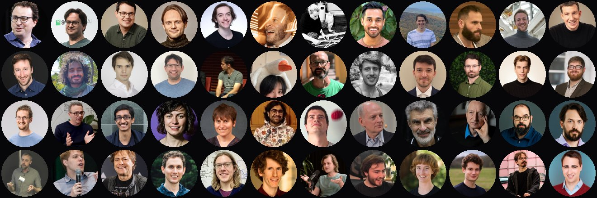</p>

## 🗣 In their own words

> *"There's risks that come from people misusing AI. Yeah, and that's most of the risks and all of the short term risks. And then there's risks that come from AI getting super smart and deciding it doesn't need us."*
>
> **[Geoffrey Hinton](https://agi-asi.github.io/safe/ai-safety-researchers/#geoffrey-hinton)**, [The Diary Of A CEO, June 2025 (transcript)](https://singjupost.com/transcript-of-godfather-of-ai-i-tried-to-warn-them-but-weve-already-lost-control/)

> *"I'm deeply concerned by the behaviors that unrestrained agentic AI systems are already beginning to exhibit—especially tendencies toward self-preservation and deception."*
>
> **[Yoshua Bengio](https://agi-asi.github.io/safe/ai-safety-researchers/#yoshua-bengio)**, [Blog post announcing LawZero, 3 June 2025](https://yoshuabengio.org/en/blog/introducing-lawzero)

> *"They have no say in whether they continue to exist because we are much smarter than they are. If we chose to, we could make them extinct in a couple of weeks and there's nothing they can do about it."*
>
> **[Stuart Russell](https://agi-asi.github.io/safe/ai-safety-researchers/#stuart-russell)**, [Explaining the 'gorilla problem', The Diary Of A CEO, Dec 2025 (transcript)](https://singjupost.com/stuart-russell-on-the-diary-of-a-ceo-podcast-transcript/)

> *"Our techniques for making A.I. that is more capable, smarter, more sophisticated, are working much better than our techniques for making A.I. that reliably does what we want it to do and reliably stays within the constraints we’ve set."*
>
> **[Helen Toner](https://agi-asi.github.io/safe/ai-safety-researchers/#helen-toner)**, [The Ezra Klein Show, The New York Times (18 Aug 2026), as quoted by CSET](https://cset.georgetown.edu/article/the-a-i-s-are-already-out-of-control/)

> *"I think one useful way to think about neural networks is that we don’t program, we don’t make them, we grow them."*
>
> **[Chris Olah](https://agi-asi.github.io/safe/ai-safety-researchers/#chris-olah)**, [Lex Fridman Podcast #452, Nov 2024](https://lexfridman.com/dario-amodei-transcript/)

> *"It’s kind of wild that we can do chain-of-thought monitoring. … We’ve been scared of these terrifying black box systems that will do inscrutable things — and they just think in English?"*
>
> **[Neel Nanda](https://agi-asi.github.io/safe/ai-safety-researchers/#neel-nanda)**, [80,000 Hours podcast (part 1), Sept 2025](https://80000hours.org/podcast/episodes/neel-nanda-mechanistic-interpretability/)

<sub>All quotes are verbatim from the linked sources. See every quote in the <a href="https://agi-asi.github.io/safe/ai-safety-researchers/">Guardians of AI</a> atlas.</sub>

## 🎬 Videos

**Motion explainers** from *Inside the Insiders*: tap any to watch on the site.

<table><tr><td align="center"><a href="https://agi-asi.github.io/safe/frominside/">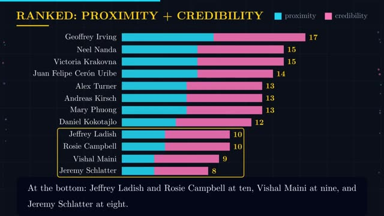</a></td><td align="center"><a href="https://agi-asi.github.io/safe/frominside/">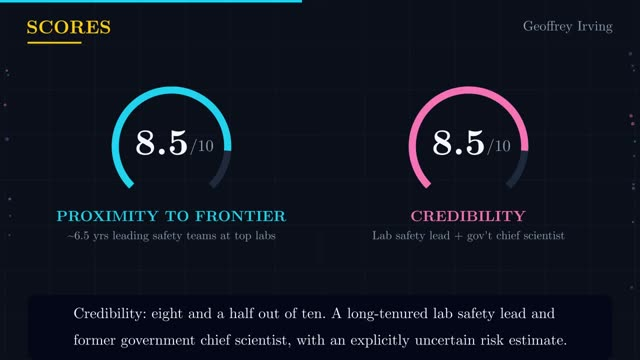</a></td><td align="center"><a href="https://agi-asi.github.io/safe/frominside/">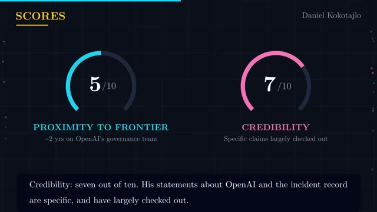</a></td><td align="center"><a href="https://agi-asi.github.io/safe/frominside/">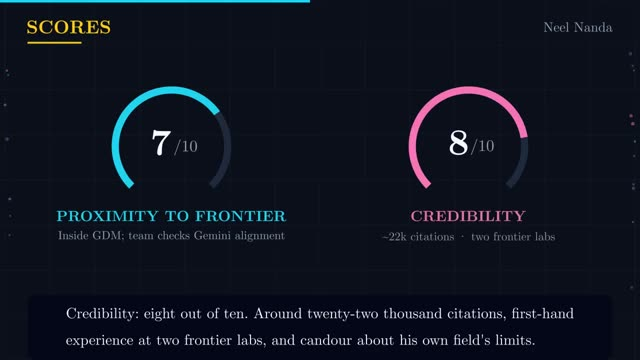</a></td></tr><tr><td align="center"><a href="https://agi-asi.github.io/safe/frominside/">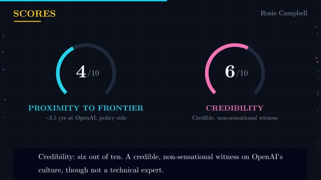</a></td><td align="center"><a href="https://agi-asi.github.io/safe/frominside/">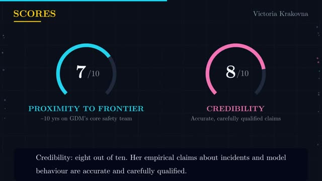</a></td><td align="center"><a href="https://agi-asi.github.io/safe/frominside/">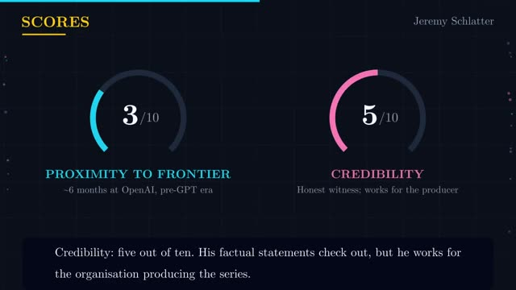</a></td><td align="center"><a href="https://agi-asi.github.io/safe/frominside/">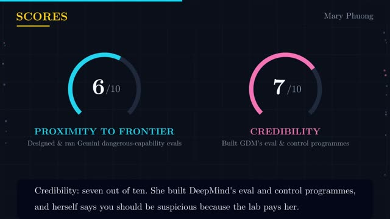</a></td></tr></table>

**The 4-minute film**: [*What 12 AI Insiders Want You to Know*](https://agi-asi.github.io/safe/control-superintelligence/) on CONTROL.

**Start-here talks** on [SIGNAL](https://agi-asi.github.io/safe/signal/): Karpathy's *Intro to Large Language Models*, Anthropic's *Interpretability: Understanding how AI models think*, and 28 more.

## 🕰 Timeline

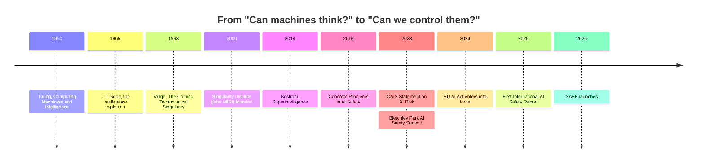

## 🧩 Landing page features

| Feature | What it does |
|---|---|
| 🌌 **Singularity hero** | Thousands of particles spiral into an event horizon that follows your cursor, over a drifting colour aurora |
| 📅 **Today strip** | Researcher of the day, today's digest headline (fetched live) and a Surprise me button |
| 🌗 **Dark / white themes** | One-tap toggle (or press `T`), remembered per device, follows your system setting by default |
| 🧭 **Section dots** | Scroll-spy navigator on the right edge and live-highlighted nav links |
| 📋 **Quote tools** | Copy any quote with its source, or post it straight to X |
| 🗺 **Route cards** | Eight colour-coded cards with 3D tilt, cursor spotlight and a GitHub **Source** chip on each |
| 🏛 **Six pillars** | Alignment, interpretability, control, evaluations, governance and the singularity, each linked to the right route |
| 🗣 **Voices carousel** | Verbatim quotes with portraits and source links, auto-advancing |
| 🍩 **People explorer** | Interactive donut + chips + search across all researchers by focus area |
| 🧭 **Pick your path** | Tabs for beginners, researchers, policy people, creators and 10-minutes-a-day readers |
| 🧠 **AI safety IQ quiz** | Eight questions with instant explanations and confetti for a good score |
| 🐙 **Built in the open** | Live GitHub stars, forks and watchers, topics, copy-to-clone, repository map |
| 📰 **Latest digest** | Pulls today's X Focus Digest headline live from the archive |
| ⌨️ **Command palette** | `⌘K` / `Ctrl K` / `/` searches every route and researcher |

### GitHub dock on every page

Every SAFE page carries a floating dock (bottom left) with a link back to the hub, a **Source** button that opens that page's folder on GitHub, and a live star count. It is one tiny shared script, [`safe-gh.js`](safe-gh.js), so new pages get it with a single tag:

```html
<script src="/safe/safe-gh.js" defer></script>
```

## 🧠 Map of the hub

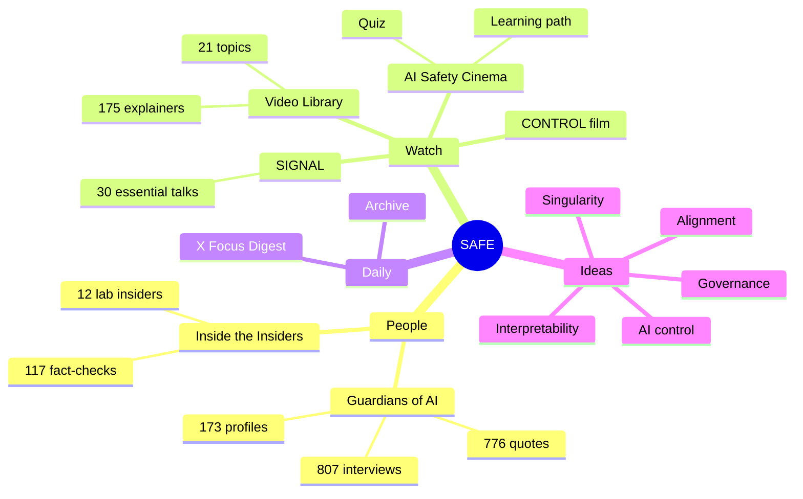

## 🗃 Data model

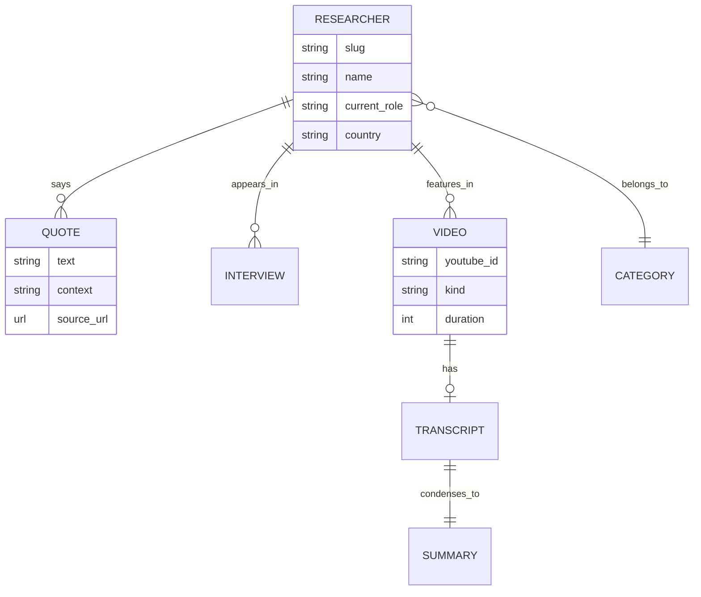

## ⌨️ Keyboard shortcuts

| Keys | Action |
|---|---|
| `⌘ K` / `Ctrl K` / `/` | Open search on the landing page |
| `↑` `↓` `Enter` | Move and open a result |
| `Esc` | Close search |
| `←` `→` | Previous / next quote |
| `T` | Toggle dark / white theme |
| `R` | Jump to a random researcher |

## 🧰 Tech stack


Zero frameworks, zero trackers, zero build step on the client.

## 🔎 Built to be found

| Layer | What's in place |
|---|---|
| **SEO** | Descriptive titles and meta, canonical URL, `robots` directives, Open Graph + Twitter cards with a 1200×630 [`og.jpg`](og.jpg), [`sitemap.xml`](sitemap.xml) (with image sitemap), [`robots.txt`](robots.txt), web manifest, icons, custom [`404.html`](404.html) |
| **Structured data** | schema.org JSON-LD: `WebSite`, `CollectionPage` + `ItemList` of routes, `FAQPage`, `DefinedTermSet` glossary, `BreadcrumbList`, author `Person` |
| **Geo** | `geo.region` IN-WB, `geo.placename` Kolkata, `geo.position` + `ICBM`, `og:locale` en_IN, hreflang `en` / `en-IN` / `x-default` |
| **GEO (AI answer engines)** | [`llms.txt`](llms.txt) summary, one-sentence definitions and Q&A written to be quoted, `robots.txt` that welcomes GPTBot, ClaudeBot, PerplexityBot and Google-Extended |
| **Accessibility** | Semantic landmarks, skip link, keyboard-first search, visible focus, `prefers-reduced-motion` support |
| **Performance** | Static files, no build step, lazy images, HLS streaming for long videos |

## 📁 Project structure

```
safe/
├── index.html                  # SAFE landing page
├── 404.html                    # custom not-found page
├── og.jpg  icon.svg  icon-192.png  icon-512.png  site.webmanifest
├── sitemap.xml  robots.txt  llms.txt  humans.txt
├── docs/                       # README screenshots and images
├── ai-safety-researchers/      # 🛡️ The Guardians of AI (data/, videos/ HLS, portraits)
├── frominside/                 # 🔍 Inside the Insiders (motion/ explainers)
├── control-superintelligence/  # 🎛️ CONTROL
├── ai-safety-cinema/           # 🎞️ AI Safety Cinema
├── ai-safety-library/          # 📚 AI Safety Video Library
├── signal/                     # 📡 SIGNAL
├── x-focus-digest/             # 📰 today's X Focus Digest
└── x-digest/                   # 🗄️ archive, one folder per day
```

## 🚀 Run locally

```bash
git clone https://github.com/Agi-Asi/safe.git
cd safe
python3 -m http.server 8000
# open http://localhost:8000
```

No dependencies and no build step. Every route is a self-contained static site, and GitHub Pages serves the `main` branch root on every push.

## ➕ Add a route

1. Create a folder such as `lab-tracker/` with its own `index.html`.
2. Add a card on the landing page and a row in the Routes table above.
3. Add its URL to `sitemap.xml` and `llms.txt`.
4. Push to `main`; Pages deploys it in about a minute.

## 🛣 Roadmap

- [ ] **Lab Safety Tracker**: every frontier lab's safety framework, system card and policy change on one timeline
- [ ] **Paper Explainers**: landmark alignment and interpretability papers, explained with animation
- [ ] **Singularity Watch**: capability milestones and forecasts from METR, AI Futures Project, Metaculus and more
- [ ] **Policy Atlas**: AI laws, summits and safety institutes worldwide, India included

## 🤝 Contributing

Spotted a wrong role, a dead link or a missing researcher? [Open an issue](https://github.com/Agi-Asi/safe/issues/new) with the source link. Corrections that come with a primary source are merged first.

## 📣 Share

[](https://x.com/intent/post?text=SAFE%3A%20the%20open%20hub%20for%20AI%20safety%2C%20alignment%20and%20superintelligence&url=https%3A%2F%2Fagi-asi.github.io%2Fsafe%2F)
[](https://www.linkedin.com/sharing/share-offsite/?url=https%3A%2F%2Fagi-asi.github.io%2Fsafe%2F)
[](https://www.reddit.com/submit?url=https%3A%2F%2Fagi-asi.github.io%2Fsafe%2F&title=SAFE%3A%20the%20open%20hub%20for%20AI%20safety)

## 📚 Cite SAFE

```bibtex
@misc{adak2026safe,
  author       = {Adak, Aniruddha},
  title        = {SAFE: An Open Hub for AI Safety, Alignment and Superintelligence},
  year         = {2026},
  howpublished = {\url{https://agi-asi.github.io/safe/}},
  note         = {GitHub: https://github.com/Agi-Asi/safe}
}
```

## 📜 Sources and credits

Quotes, interviews and videos belong to their original authors, publishers and channels; each is linked to its source. Interviews in *Inside the Insiders* are by frominside.ai / Palisade Research (CC BY 4.0). Researcher roles were verified in 2025–2026.

## 👋 About

**SAFE** is created and maintained by **Aniruddha Adak**, an AI Agent Engineer, full-stack developer and AI filmmaker from Kolkata, India.

[](https://github.com/Agi-Asi)
[](https://github.com/aniruddhaadak80)
[](https://www.youtube.com/@ai-asi)
[](https://www.linkedin.com/in/aniruddha-adak)
[](https://x.com/asi369_)
[](https://dev.to/aniruddhaadak)

## ⭐ Star history

[](https://star-history.com/#Agi-Asi/safe&Date)

<div align="center"><sub>If SAFE helps you, star the repo and share it. The more people understand what's being built, the better our odds.</sub></div>
